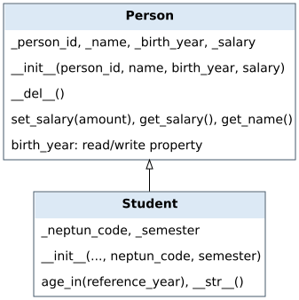
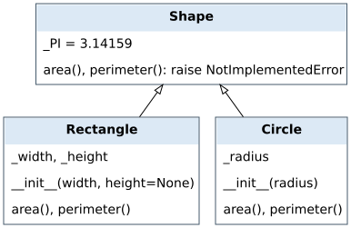
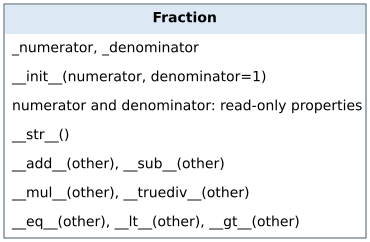

**Six in-class exercises · 150 minutes of coding**

Use explicit loops and conditions. Do not use imports, break, continue, comprehensions, lambda, map/filter or built-in algorithm shortcuts (such as sum, min, max, sorted or math.gcd). Use CapWords class names, snake_case methods and parameters, self for instance methods, and _leading_underscore for non-public state. Use the public methods and properties when working with an object from outside its class. Inside a class, its own implementation may use its backing fields; use the public interface for other objects. Use super() to initialize inherited state. Each solution must be self-contained: copy the previous class into the current exercise where requested.

Exercises 2, 3 and 6 build on earlier work. Paste the earlier class into the new editor when requested. **Run** displays output. **Check solution** tests behavior with additional objects. Naming and encapsulation also need manual review. Code is saved in this browser while you work. **Evaluate my work** uploads your Neptun code, solutions and activity metrics to Azure. AI feedback is optional and is not an official grade.

```{=html}
<style>
#oop-week10 .oop-task {border:1px solid #aab4bd;border-radius:8px;padding:1rem;margin:1rem 0}
#oop-week10 summary {font-weight:600;cursor:pointer}
#oop-week10 textarea {display:block;width:100%;min-height:14rem;font-family:monospace;tab-size:4}
#oop-week10 pre {white-space:pre-wrap;overflow-wrap:anywhere}
</style>
<div id="oop-week10">
<p><label for="oop-neptun">Neptun code</label> <input id="oop-neptun" maxlength="6" autocomplete="off"></p>
<p id="oop-timing-note">Timing counts focused time with the most recently opened exercise expanded.</p>
<details class="oop-task"><summary>Exercise 1 – Person: class and instance (15 minutes)</summary>
<p>Define Person with __init__(self, person_id, name, birth_year, salary). Store these values as _person_id, _name, _birth_year and _salary. Define __del__ so that it prints Goodbye, followed by the person&#x27;s name (for example, Goodbye, Joe White). Create p = Person(2023, &#x27;Joe White&#x27;, 1995, 5600). You can try del p in a separate demonstration; the timing of finalization is not graded.</p>
<details><summary>Class diagram</summary></details>
<label for="oop-code-1">Python solution</label>
<textarea id="oop-code-1" spellcheck="false">class Person:
    def __init__(self, person_id, name, birth_year, salary):
        pass

    def __del__(self):
        pass

</textarea>
<p><button type="button" data-run="1">Run</button> <button type="button" data-check="1">Check solution</button> <button type="button" data-stop>Stop</button></p>
<pre id="oop-out-1" role="status"></pre></details>
<details class="oop-task"><summary>Exercise 2 – Person: public methods and property (15 minutes)</summary>
<p>Copy your Person class from Exercise 1. Add set_salary(amount) and get_name(). Reject a negative salary with ValueError; add get_salary() so callers can check the updated value without reading _salary. Use @property and @birth_year.setter for birth_year. Accept positive integer years only; raise ValueError otherwise. Use the same validation when initializing salary and birth_year. Demonstrate the public interface.</p>
<details><summary>Class diagram</summary></details>
<label for="oop-code-2">Python solution</label>
<textarea id="oop-code-2" spellcheck="false"># Paste and extend your Person class here.
</textarea>
<p><button type="button" data-run="2">Run</button> <button type="button" data-check="2">Check solution</button> <button type="button" data-stop>Stop</button></p>
<pre id="oop-out-2" role="status"></pre></details>
<details class="oop-task"><summary>Exercise 3 – Student: inheritance (30 minutes)</summary>
<p>Copy your Person class from Exercise 2. Define Student(Person) with parameters person_id, name, birth_year, salary, neptun_code, semester. Initialize Person with super().__init__, and store the two new fields with leading underscores. Implement age_in(reference_year), returning reference_year minus birth_year (year-based estimate), and __str__, returning &#x27;Name (Neptun: CODE, semester: N)&#x27;. Test one Student instance through its public interface.</p>
<details><summary>Class diagram</summary></details>
<label for="oop-code-3">Python solution</label>
<textarea id="oop-code-3" spellcheck="false"># Paste Person here, then define Student.
</textarea>
<p><button type="button" data-run="3">Run</button> <button type="button" data-check="3">Check solution</button> <button type="button" data-stop>Stop</button></p>
<pre id="oop-out-3" role="status"></pre></details>
<details class="oop-task"><summary>Exercise 4 – Shape: rectangle and circle (30 minutes)</summary>
<p>Define Shape with non-public class constant _PI = 3.14159. Its area() and perimeter() raise NotImplementedError. Define Rectangle(width, height=None) and Circle(radius) as subclasses with non-public dimensions and overridden methods. A rectangle with no height is a square. Assume dimensions are positive. Use the inherited constant for circle calculations. Test a rectangle, a square and a circle through their public methods.</p>
<details><summary>Class diagram</summary></details>
<label for="oop-code-4">Python solution</label>
<textarea id="oop-code-4" spellcheck="false"># Define Shape, Rectangle and Circle here.
</textarea>
<p><button type="button" data-run="4">Run</button> <button type="button" data-check="4">Check solution</button> <button type="button" data-stop>Stop</button></p>
<pre id="oop-out-4" role="status"></pre></details>
<details class="oop-task"><summary>Exercise 5 – Fraction: arithmetic operators (40 minutes)</summary>
<p>Define Fraction(numerator, denominator=1) with non-public fields and read-only numerator and denominator properties. Use integer inputs. Raise ValueError for a zero denominator. Reduce each fraction with a loop-based GCD and keep the denominator positive. Implement __str__ as numerator/denominator (also for denominator 1). Implement +, -, * and / between Fraction objects; return new instances and leave operands unchanged. Raise ZeroDivisionError when dividing by a fraction with numerator zero. Return NotImplemented for unsupported operand types. Try 1/2 and 3/4: the four operations should give 5/4, -1/4, 3/8 and 2/3. Fraction(4) minus Fraction(1, 2) should give 7/2.</p>
<details><summary>Class diagram</summary></details>
<label for="oop-code-5">Python solution</label>
<textarea id="oop-code-5" spellcheck="false"># Define Fraction here.
</textarea>
<p><button type="button" data-run="5">Run</button> <button type="button" data-check="5">Check solution</button> <button type="button" data-stop>Stop</button></p>
<pre id="oop-out-5" role="status"></pre></details>
<details class="oop-task"><summary>Exercise 6 – Fraction: comparison operators (20 minutes)</summary>
<p>Copy your Fraction class from Exercise 5 and add __eq__, __lt__ and __gt__. Compare fractions exactly using cross multiplication, without converting to float. Return NotImplemented for unsupported operands. Test equivalent fractions, different fractions and negative values. This is an in-class exercise.</p>
<details><summary>Class diagram</summary></details>
<label for="oop-code-6">Python solution</label>
<textarea id="oop-code-6" spellcheck="false"># Paste Fraction and add its three comparison methods.
</textarea>
<p><button type="button" data-run="6">Run</button> <button type="button" data-check="6">Check solution</button> <button type="button" data-stop>Stop</button></p>
<pre id="oop-out-6" role="status"></pre></details>
<p><button type="button" id="oop-evaluate">Evaluate my work</button></p>
<pre id="oop-summary" role="status"></pre>
<p id="oop-save" role="status"></p>
<button id="oop-ai" type="button" hidden>Request AI feedback &amp; estimated score</button>
<pre id="oop-ai-output" role="status"></pre>
</div>
<script>
(() => {
  const api = "https://itarch-backend-fpdsf6brfpanf5d8.northeurope-01.azurewebsites.net/api";
  const neptun = el => el('oop-neptun').value.trim().toUpperCase();
  async function post(route, payload) {
    const r = await fetch(api+'/'+route, {method:'POST',headers:{'Content-Type':'application/json'},body:JSON.stringify(payload)});
    const result = await r.json();
    if (!r.ok) throw Error(result.error || 'Request failed (HTTP '+r.status+').');
    return result;
  }
  const cases = ["p = ns[\"p\"]\nassert type(p) is ns[\"Person\"], \"Create p as a Person instance.\"\nassert (p._person_id, p._name, p._birth_year, p._salary) == (2023, \"Joe White\", 1995, 5600), \"Check p's initial state.\"\nstream = io.StringIO()\nwith contextlib.redirect_stdout(stream):\n    p.__del__()\nassert stream.getvalue().strip() == \"Goodbye, Joe White\", \"Check the finalizer message.\"", "p = ns[\"Person\"](7, \"Ada Smith\", 2001, 900)\nassert p.get_name() == \"Ada Smith\"\np.set_salary(1200)\nassert p.get_salary() == 1200\np.birth_year = 2002\nassert p.birth_year == 2002\nreject(lambda: p.set_salary(-1), \"negative salary\")\nreject(lambda: setattr(p, \"birth_year\", 0), \"invalid year\")\nreject(lambda: setattr(p, \"birth_year\", 2000.5), \"non-integer year\")\nreject(lambda: ns[\"Person\"](7, \"Ada\", 0, 900), \"invalid initial year\")\nreject(lambda: ns[\"Person\"](7, \"Ada\", 2000, -1), \"invalid initial salary\")\nassert p.birth_year == 2002 and p.get_salary() == 1200", "p = ns[\"Student\"](1, \"Ada Smith\", 2001, 900, \"ABC123\", 2)\nassert isinstance(p, ns[\"Person\"])\nassert p.get_name() == \"Ada Smith\" and p.age_in(2026) == 25 and p.age_in(2030) == 29\nassert str(p) == \"Ada Smith (Neptun: ABC123, semester: 2)\"", "S, R, C = ns[\"Shape\"], ns[\"Rectangle\"], ns[\"Circle\"]\nfor name in (\"area\", \"perimeter\"):\n    try:\n        getattr(S(), name)()\n    except NotImplementedError:\n        pass\n    else:\n        raise AssertionError(\"Base \" + name + \"() must raise NotImplementedError.\")\nfor shape, area, perimeter in [(R(3,4),12,14),(R(5),25,20),(C(2),12.56636,12.56636),(C(3),28.27431,18.84954)]:\n    assert isinstance(shape,S)\n    assert abs(shape.area()-area)<0.00001 and abs(shape.perimeter()-perimeter)<0.00001", "F = ns[\"Fraction\"]\na,b = F(1,2),F(3,4)\nassert [str(a+b),str(a-b),str(a*b),str(a/b),str(F(4)-a)] == [\"5/4\",\"-1/4\",\"3/8\",\"2/3\",\"7/2\"]\nassert str(a) == \"1/2\" and str(b) == \"3/4\"\nassert str(F(6,-8)) == \"-3/4\" and str(F(0,-5)) == \"0/1\"\nassert F(6,8).numerator == 3 and F(6,8).denominator == 4\nreject(lambda: F(1,0), \"zero denominator\")\ntry:\n    a / F(0)\nexcept ZeroDivisionError:\n    pass\nelse:\n    raise AssertionError(\"Division by a zero fraction must raise ZeroDivisionError.\")", "F = ns[\"Fraction\"]\nassert F(1,2)==F(2,4) and not F(1,2)==F(2,3)\nassert F(-3,4)<F(-1,2) and F(5,6)>F(3,4)\nassert not F(1,2)<F(2,4) and not F(1,2)>F(2,4)\nassert F(10**20,10**20+1)<F(1)\nassert F(1,2).__eq__(0) is NotImplemented\nassert F(1,2).__lt__(0) is NotImplemented and F(1,2).__gt__(0) is NotImplemented"];
  const el = id => document.getElementById(id);
  const root = el('oop-week10');
  let worker, cancel, busy = false;
  const run = (source, checks) => new Promise(resolve => {
    let timer;
    function finish(result, reset = false) {
      clearTimeout(timer);
      cancel = null;
      if (reset) { worker?.terminate(); worker = null; }
      resolve(result);
    }
    try {
      if (!worker) worker = new Worker(new URL('assets/week10-python-worker.js', document.baseURI));
      cancel = () => finish([false, 'Run stopped.'], true);
      timer = setTimeout(() => finish([false,'Python did not load in time.'],true),45000);
      worker.onerror = () => finish([false,'Python worker could not load.'],true);
      worker.onmessage = ({data}) => {
        if (data.ready) {
          clearTimeout(timer);
          timer = setTimeout(() => finish([false,'Execution timed out.'],true),4000);
        } else finish(data.result || [false,data.error], Boolean(data.error));
      };
      worker.postMessage({source, checks});
    } catch (e) { finish([false,String(e)],true); }
  });
  const activity = cases.map(()=>({ms:0,run:0,check:0,started:false}));
  const cards = Array.from(root.querySelectorAll('.oop-task'));
  let focused = null, last = performance.now(), savedEvaluation = null;
  function accrue() {
    const now = performance.now();
    if (focused !== null) activity[focused].ms += now-last;
    last = now;
    const open = cards.findIndex(c=>c.open);
    focused = !document.hidden && document.hasFocus() && open >= 0 ? open : null;
  }
  cards.forEach((card,i)=>card.addEventListener('toggle',()=>{
    accrue();
    if (card.open) {
      cards.forEach(other=>{if(other!==card)other.open=false;});
      activity[i].started=true;
      accrue();
    }
  }));
  ['focus','blur'].forEach(e=>window.addEventListener(e,accrue));
  document.addEventListener('visibilitychange',accrue);
  const idField = el('oop-neptun');
  idField.oninput = () => {idField.value=neptun(el).replace(/[^A-Z0-9]/g,'').slice(0,6);};
  const fields = cases.map((_,i) => el('oop-code-'+(i+1)));
  fields.forEach((field,i) => {
    const key = 'week10-oop-exercise-'+i;
    try { const saved = localStorage.getItem(key); if (saved !== null) field.value = saved; } catch {}
    field.addEventListener('input', () => { try { localStorage.setItem(key,field.value); } catch {} });
  });
  let cancelled = false;
  root.querySelectorAll('[data-stop]').forEach(b => b.onclick = () => {cancelled = true; cancel?.();});
  async function perform(indices, check) {
    if (busy) return;
    busy = true; cancelled = false;
    const codes = fields.map(f => f.value);
    const summary = el('oop-summary');
    const rows = [], results = [];
    if (indices.length > 1) summary.textContent = 'Checking all exercises…';
    try {
      for (const i of indices) {
        if (cancelled) break;
        const output = el('oop-out-'+(i+1));
        output.textContent = 'Running…';
        if (indices.length === 1) activity[i][check?'check':'run']++;
        if (indices.length === 1) activity[i].started=true;
        const [ok, message, meta] = await run(codes[i], check ? cases[i] : '');
        output.textContent = (check ? (ok ? 'Passed' : 'Check failed')+'\n' : '') + (message || 'No printed output.');
        results.push({ok,meta});
        rows.push('Exercise '+(i+1)+': '+(ok ? 'Passed' : 'Check failed'));
      }
      if (indices.length > 1) summary.textContent = [...rows,...(cancelled?['Evaluation stopped.']:[])].join('\n');
    } finally { busy = false; }
    return cancelled?null:{results,codes};
  }
  root.querySelectorAll('[data-run]').forEach(b => b.onclick = () => perform([Number(b.dataset.run)-1],false));
  root.querySelectorAll('[data-check]').forEach(b => b.onclick = () => perform([Number(b.dataset.check)-1],true));
  const evalButton = el('oop-evaluate'), aiButton = el('oop-ai'), status = el('oop-save'), aiOutput = el('oop-ai-output');
  let evaluationNo = 0;
  try { evaluationNo = Number(sessionStorage.getItem('week10-evaluation-no'))||0; } catch {}
  evalButton.onclick = async () => {
    if (busy || evalButton.disabled) return;
    const id = neptun(el);
    if (!/^[A-Z0-9]{6}$/.test(id)) {status.textContent='Enter a valid six-character Neptun code.';idField.focus();return;}
    evalButton.disabled=true; aiButton.hidden=true; savedEvaluation=null; aiOutput.textContent='';
    status.textContent='';
    try {
      const evaluation=await perform(cases.map((_,i)=>i),true);
      if (!evaluation) return;
      const {results,codes}=evaluation;
      if (neptun(el)!==id || fields.some((f,i)=>f.value!==codes[i])) {
        status.textContent='Your code or Neptun code changed. Evaluate again before saving.';return;
      }
      accrue();
      const exercises=results.map(({ok,meta},i)=>({
        exercise_id:'ex'+String(i+1).padStart(2,'0'),source_code:codes[i],
        started:activity[i].started || codes[i]!==fields[i].defaultValue,
        attempted:codes[i].trim()!=='' && codes[i].trim()!==fields[i].defaultValue.trim(),
        active_time_seconds:Math.round(activity[i].ms/1000),
        run_count:activity[i].run,check_count:activity[i].check,
        completed:ok,syntax:!!meta?.syntax,rules:!!meta?.rules,functional:ok
      }));
      const completed=exercises.filter(x=>x.completed).length;
      const score=Math.round(completed/exercises.length*100);
      el('oop-summary').textContent+='\nAutomatic checks: '+completed+'/'+exercises.length+' ('+score+'%).';
      evaluationNo=evaluationNo%999+1;
      try {sessionStorage.setItem('week10-evaluation-no',String(evaluationNo));}catch{}
      status.textContent='Saving evaluation…';
      const data=await post('submitPractice',{week:'10',neptun:id,evaluation_no:evaluationNo,
        evaluated_at:new Date().toISOString(),indicative_score:score,
        summary:{attempted:exercises.filter(x=>x.attempted).length,completed,functional_passed:completed,rules_passed:exercises.filter(x=>x.rules).length,total:exercises.length},exercises});
      if (!data.saved || !data.feedback_token) throw Error('Azure did not confirm the save.');
      status.textContent='Evaluation saved in Azure.';
      savedEvaluation={id,codes,evaluation_id:data.evaluation_id,feedback_token:data.feedback_token};
      aiButton.hidden=false;
    } catch(e){status.textContent='Local checks remain available. Azure: '+e.message;}
    finally{evalButton.disabled=false;}
  };
  aiButton.onclick=async()=>{
    const s=savedEvaluation;
    if(!s || neptun(el)!==s.id || fields.some((f,i)=>f.value!==s.codes[i])){
      aiOutput.textContent='Your work has changed. Evaluate again first.';return;
    }
    aiButton.disabled=true;aiOutput.textContent='Requesting AI feedback…';
    try{
      const d=await post('practiceFeedback',{action:'ai',neptun:s.id,evaluation_id:s.evaluation_id,feedback_token:s.feedback_token});
      if(savedEvaluation!==s)return;
      aiOutput.textContent='Estimated AI score: '+d.ai.estimated_percent+'% (not an official grade)\n'+d.ai.exercises.map(x=>x.title+': '+x.percent+'% — '+x.feedback).join('\n');
    }catch(e){if(savedEvaluation===s)aiOutput.textContent=e.message;}
    finally{aiButton.disabled=false;}
  };
})();
</script>
```
